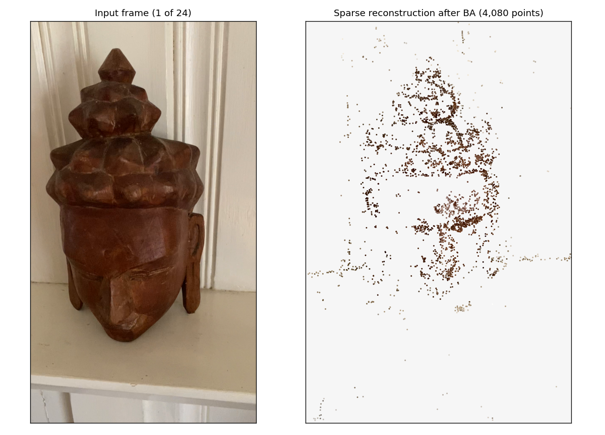
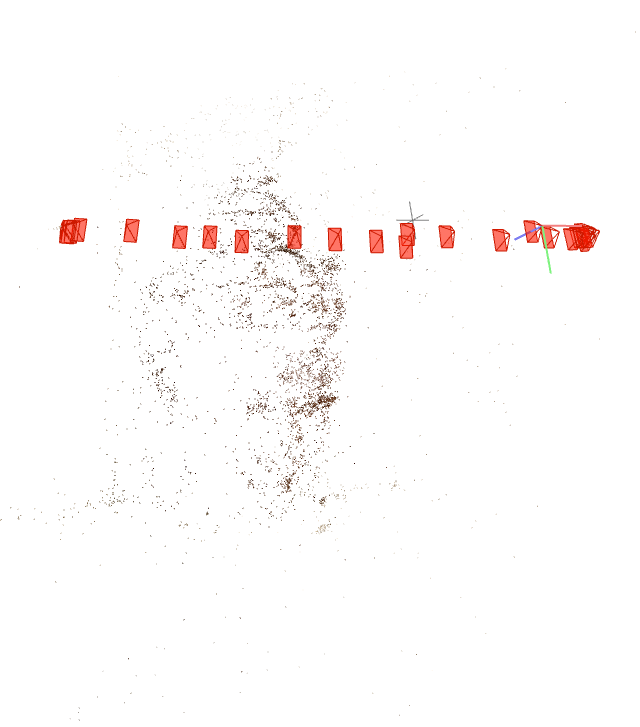
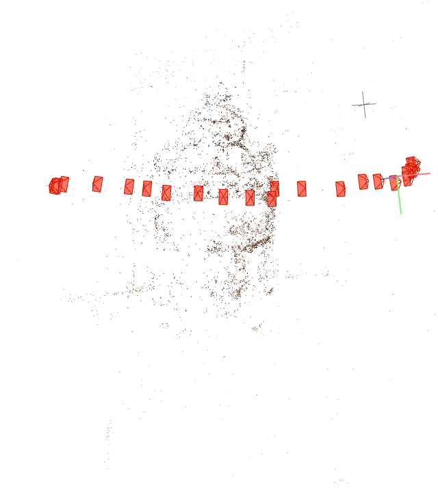

# Incremental Structure-from-Motion

An incremental sparse **Structure-from-Motion** pipeline that recovers camera poses and a 3D point cloud from a monocular image sequence. The geometry core (fundamental and essential matrices, pose recovery, triangulation, multi-view tracks) is implemented from scratch, and the repository contains two implementations:

- **Python** (`sfm/`, `SFM.ipynb`): the reference implementation, with bundle adjustment in **GTSAM**.
- **C++17** (`cpp/`): a module-by-module port with bundle adjustment in **Ceres**, a command-line pipeline, and a test for every module.

On a 24-image sequence, both register all 24 cameras. The C++ pipeline reaches **0.39 px** final reprojection RMSE (Python: 3.36 px) and leaves no points behind any camera.

<p align="center">
  
</p>

## Contents

- [Results](#results)
- [Pipeline](#pipeline)
- [Repository structure](#repository-structure)
- [Getting started](#getting-started)
- [Viewing results in COLMAP](#viewing-results-in-colmap)
- [Implementation notes](#implementation-notes)
- [Limitations and future work](#limitations-and-future-work)

## Results

Dataset: 24 frames (1080 × 1920) of a carved wooden Buddha head, with per-frame `SIMPLE_RADIAL` intrinsics in COLMAP format (`cameras.txt`).

| Metric | Python (GTSAM) | C++ (Ceres) |
|---|---:|---:|
| Registered images | 24 / 24 | 24 / 24 |
| 3D points before / after BA | 5,505 / 5,490 | 4,102 / 4,080 |
| Points behind a camera before BA | 15 | 0 |
| BA cost reduction | 66.7% | 76.8% (round 1) |
| Final reprojection RMSE, √(cost / 2N) | 3.36 px | 0.39 px |
| Reprojection error after BA, median / p90 | — | 0.50 / 1.37 px |
| Bundle adjustment time | — | 0.33 s |
| End-to-end runtime | — | ≈ 32 s (mostly SIFT matching) |

The two versions optimize different observation sets: the C++ pipeline removes outliers and inconsistent tracks before and during bundle adjustment. The RMSE gap therefore reflects that cleanup as well as the optimizer. The C++ version keeps fewer points because it rejects points triangulated from nearly identical viewpoints, whose depth is unreliable (see [Implementation notes](#implementation-notes)).

### Bundle adjustment (C++)


Top and front views in the cameras' frame. Red triangles are cameras; blue circles mark their positions before bundle adjustment. BA levels the shelf edge and the back wall, tightens the head (median point distance from the center 4.44 → 3.46), and pulls back cameras 0–3, which had drifted by up to 1.8× the spacing between neighbouring cameras at the end of the longest registration chain. The median reprojection error falls from 1.04 px to 0.50 px.

### Minimum triangulation angle (C++)


Cameras 0–3 are nearly co-located, so points triangulated mainly from them have almost no parallax and smear along their viewing rays (the diagonal streak in the top-left panel). A 1.5° minimum triangulation angle removes them: no point lies beyond 7× the median distance from the cloud center, compared with 29 beyond 10× without the filter. It also removes the ill-conditioning these points caused in bundle adjustment, which converges in 34 iterations instead of 96.

### Bundle adjustment (Python)

| Before BA | After BA |
|:---:|:---:|
|  |  |

## Pipeline

```text
Images + intrinsics
  → SIFT features and pairwise matching, verified by RANSAC on F
  → Multi-view tracks (union-find)
  → Seed pair: essential matrix, cheirality check, triangulation
  → Incremental registration: PnP-RANSAC forward and backward from the seed, map growth
  → Retriangulation of remaining tracks
  → Bundle adjustment (GTSAM in Python, Ceres in C++)
  → Export: COLMAP sparse model, point cloud (Open3D in Python, PLY in C++)
```

1. **Feature matching.** SIFT keypoints, Lowe ratio test, and geometric verification with a RANSAC fundamental matrix scored by Sampson error. Pairs are matched within a sliding window of 8 frames. The Python version also offers a SuperPoint + LightGlue front end.
2. **Two-view geometry.** Normalized 8-point algorithm, rank-2 enforcement, essential matrix E = Kⱼᵀ F Kᵢ, the four (R, t) hypotheses, and a cheirality check to pick the valid one.
3. **Tracks.** Pairwise matches are merged into multi-view tracks with union-find.
4. **Incremental mapping.** The seed pair defines the world frame. Each new image is registered by PnP-RANSAC against already triangulated tracks, then its unmapped tracks are triangulated against every registered neighbour. Remaining tracks are retriangulated from their widest-baseline pair of views.
5. **Bundle adjustment.** Joint optimization of all camera poses and 3D points with a robust Huber loss and Levenberg–Marquardt.
6. **Export.** COLMAP text and binary models for inspection in the COLMAP GUI, plus a colored point cloud.

## Repository structure

```text
.
├── SFM.ipynb                  # Python pipeline, end to end
├── sfm/                       # Python package
│   ├── io.py                  # Image and cameras.txt loading
│   ├── geometry.py            # F, E, pose recovery, triangulation
│   ├── matching.py            # SIFT matching and verification
│   ├── matching_superpoint.py # Optional SuperPoint + LightGlue front end
│   ├── tracks.py              # Multi-view tracks (union-find)
│   ├── mapping.py             # Seed, PnP registration, retriangulation
│   ├── ba.py                  # GTSAM bundle adjustment
│   ├── viz.py                 # Open3D visualization
│   ├── colmap_export.py       # COLMAP model export
│   └── rng.py                 # Reproducible seeding
├── cpp/                       # C++17 implementation (see cpp/README.md)
│   ├── include/sfm/           # One header per module
│   ├── src/                   # Modules and main.cpp (sfm_pipeline)
│   ├── tests/                 # Per-module tests
│   └── CMakeLists.txt
├── buddha_images/             # Input frames
├── cameras.txt                # Per-frame intrinsics (COLMAP SIMPLE_RADIAL)
├── Assets/                    # Figures
└── requirements.txt           # Python dependencies
```

## Getting started

### Python

Requires Python 3.10+. Install the dependencies, then run `SFM.ipynb` from the repository root:

```bash
pip install -r requirements.txt
```

The optional SuperPoint + LightGlue front end needs PyTorch and:

```bash
pip install git+https://github.com/cvg/LightGlue.git
```

The notebook writes COLMAP models to `colmap_exports/before_ba` and `colmap_exports/after_ba`.

### C++

Requires a C++17 compiler, CMake 3.16+, OpenCV 4, Eigen 3.3+ and Ceres 2.x. Build and run from the repository root:

```bash
cmake -S cpp -B cpp/build && cmake --build cpp/build -j
```

```bash
./cpp/build/sfm_pipeline --data-dir .
```

This writes COLMAP models (`before_ba/`, `after_ba/`) and colored PLY point clouds to `colmap_exports_cpp/`. Common options:

| Option | Effect |
|---|---|
| `--seed I J` / `--auto-seed` | Seed pair (default 15 16), or select it automatically by parallax |
| `--min-tri-angle A` | Minimum triangulation angle in degrees (default 1.5; 0 disables) |
| `--no-undistort` | Use raw keypoint positions instead of removing lens distortion |
| `--gui before\|after` | Open the chosen model in the COLMAP GUI when finished |

The full option list, the per-module tests and a detailed comparison with the Python version are in [`cpp/README.md`](cpp/README.md).

### Using your own images

Place the frames in `buddha_images/` (PNG, processed in filename order) and provide a matching `cameras.txt` in COLMAP text format with one `SIMPLE_RADIAL` camera per frame, where camera *i* + 1 belongs to the *i*-th image.

## Viewing results in COLMAP

COLMAP is optional and only needed to inspect the exported models. Use `colmap_exports/after_ba` for the Python output or `colmap_exports_cpp/after_ba` for the C++ output:

```bash
colmap gui \
  --database_path buddha_images/database.db \
  --image_path buddha_images \
  --import_path colmap_exports_cpp/after_ba \
  --Render.min_track_len 2 \
  --Render.max_error 10
```

`--Render.min_track_len 2` shows points observed in only two images, which COLMAP hides by default. Both exporters regenerate the binary files so that COLMAP never reads a stale `.bin` model.

## Implementation notes

- **Intrinsics** are fixed and read from `cameras.txt`. The C++ pipeline removes the `SIMPLE_RADIAL` distortion from every keypoint before matching, so the pinhole model used by F estimation, PnP, triangulation and bundle adjustment is exact. The Python pipeline uses pinhole intrinsics (`Cal3_S2`) throughout.
- **Reproducibility.** Both pipelines fix the random seed and run OpenCV single-threaded; repeated C++ runs produce identical results.
- **Gauge.** The C++ bundle adjustment holds the seed camera fixed and fixes the overall scale with one translation component of the second seed camera. The Python version anchors one camera with a tight prior.

The C++ port also makes the following changes to the Python algorithm:

| Change | Effect on this dataset |
|---|---|
| Depth is checked in both cameras when new points are triangulated (the Python version tests world *z*) | Points behind a camera before BA: 15 → 0 |
| Tracks containing two keypoints from the same image are dropped | Observations with > 10 px error before BA halved |
| F is refit on all RANSAC inliers | Recall on a synthetic benchmark 0.895 → 0.948, with no extra outliers |
| New views need ≥ 12 PnP inliers; new points pass a reprojection check | Poorly supported poses and points are rejected |
| 1.5° minimum triangulation angle | Low-parallax points removed; BA converges in 34 instead of 96 iterations |
| BA in two rounds: remove > 10 px, solve, remove > 4 px, solve again | Outliers no longer bias the solution |

## Limitations and future work

- Intrinsics are not refined during bundle adjustment.
- No loop closure or global pose-graph optimization; drift is corrected only by bundle adjustment.
- Sparse reconstruction only; dense multi-view stereo is not included.
- The seed pair is fixed by default; automatic selection is available in the C++ pipeline but not tuned.
- Learned features (SuperPoint + LightGlue) are available only in the Python version.
