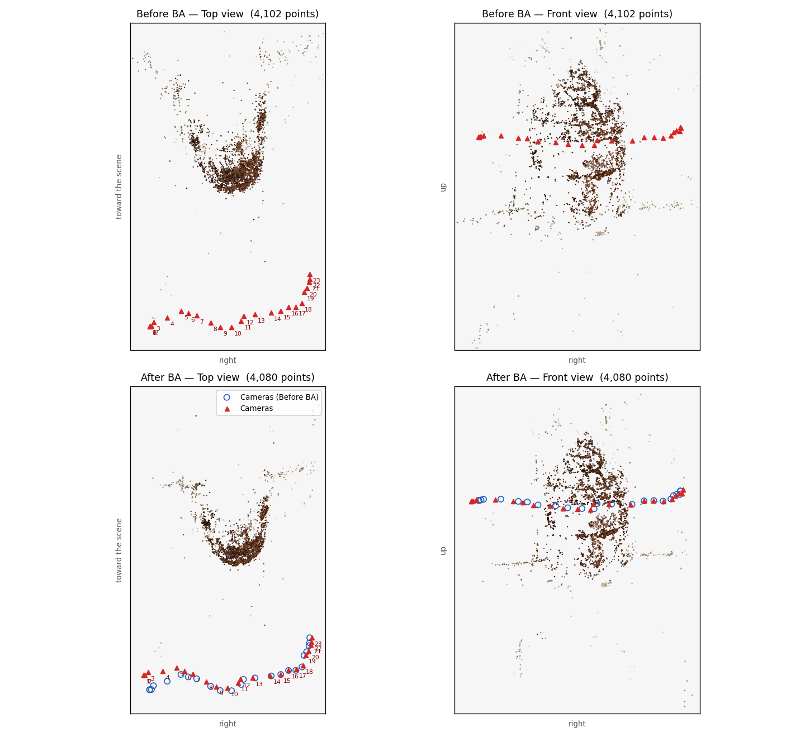
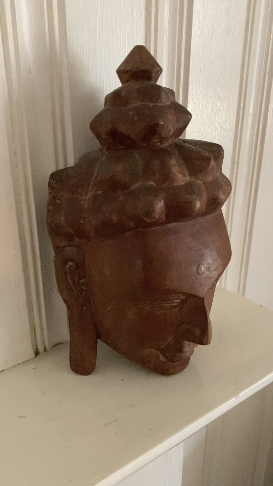

# Incremental Structure-from-Motion

A from-scratch **incremental sparse SfM** pipeline that reconstructs camera poses and a 3D landmark cloud from a monocular image sequence. The geometry stack (fundamental / essential matrices, triangulation, PnP, tracks) is implemented in Python; bundle adjustment uses **GTSAM**.

A **C++17 port** in [`cpp/`](cpp/) reimplements the same pipeline with **Ceres** bundle adjustment, fixes several issues found along the way, and reaches **0.39 px** reprojection RMSE vs ~3.4 px for the Python version (see [C++ implementation](#c-implementation-ceres)).

## Pipeline

```text
Images + intrinsics
  → SIFT features & pairwise matching (RANSAC F)
  → Global tracks (Union-Find)
  → Seed pair (E-matrix, cheirality, triangulation)
  → Bidirectional PnP registration + map growth
  → Retriangulation of leftover tracks
  → GTSAM bundle adjustment
  → Open3D visualization / COLMAP export
```

**Core stages**

1. **Feature matching** — SIFT + Lowe ratio test + RANSAC fundamental matrix (Sampson error). Optional SuperPoint + LightGlue front-end.
2. **Two-view geometry** — normalized 8-point `F`, essential matrix `E = Kⱼᵀ F Kᵢ`, pose hypotheses, cheirality selection.
3. **Incremental mapping** — seed triangulation, `solvePnPRansac` localization, neighbor triangulation, global retriangulation.
4. **Bundle adjustment** — robust (Huber) projection factors in GTSAM; joint pose + landmark LM optimization.
5. **Visualization / export** — Open3D viewer; COLMAP-compatible sparse models for the COLMAP GUI.

## Repository layout

```text
.
├── SFM.ipynb              # End-to-end runner notebook
├── sfm/                   # Pipeline package
│   ├── io.py              # Image + COLMAP cameras.txt loading
│   ├── geometry.py        # F / E / pose / triangulation
│   ├── matching.py        # SIFT matching
│   ├── matching_superpoint.py  # Optional SuperPoint + LightGlue
│   ├── tracks.py          # Multi-view tracks
│   ├── mapping.py         # Seed, PnP expansion, retriangulation
│   ├── ba.py              # GTSAM bundle adjustment
│   ├── viz.py             # Open3D visualization
│   ├── colmap_export.py   # Export for COLMAP GUI
│   └── rng.py             # Reproducible seeding
├── cpp/                   # C++17 port (Ceres BA); see cpp/README.md
│   ├── include/sfm/       # Headers, one per module
│   ├── src/               # Modules + main.cpp (sfm_pipeline)
│   ├── tests/             # Per-module tests (synthetic + real data)
│   └── CMakeLists.txt
├── buddha_images/         # Input RGB frames
├── cameras.txt            # Per-view intrinsics (SIMPLE_RADIAL)
├── Assets/                # Reconstruction figures
├── colmap_exports/        # Exported before/after-BA models
└── requirements.txt
```

## Requirements

- Python 3.10+
- OpenCV
- NumPy
- Open3D
- GTSAM
- Jupyter

Optional:

- PyTorch (CUDA recommended)
- LightGlue + SuperPoint

```bash
pip install -r requirements.txt

# Optional SuperPoint / LightGlue frontend
pip install git+https://github.com/cvg/LightGlue.git
```

COLMAP is only required if you want to inspect exported models in the COLMAP GUI.

---

## Quick Start

1. Place your images inside `buddha_images/`.
2. Provide a matching `cameras.txt` in COLMAP text format (`SIMPLE_RADIAL`).
3. Open and run `SFM.ipynb`.

## COLMAP GUI

Exported models are written to

```
colmap_exports/before_ba
colmap_exports/after_ba
```

Visualize them with

```bash
colmap gui \
  --database_path buddha_images/database.db \
  --image_path buddha_images \
  --import_path colmap_exports/after_ba
```

The exporter regenerates the binary files to avoid stale `.bin` models.

---

## C++ implementation (Ceres)

[`cpp/`](cpp/) is a module-by-module C++17 port of the Python package. Two-view geometry (normalized 8-point, RANSAC with Sampson error, essential matrix, pose decomposition, DLT triangulation) is written from scratch on Eigen; OpenCV provides SIFT, matching and `solvePnPRansac`; bundle adjustment uses Ceres. Every module has its own test against synthetic ground truth and the real data. Full details are in [`cpp/README.md`](cpp/README.md).

Requires OpenCV 4, Eigen 3.3+, Ceres 2.x and CMake 3.16+. From the repository root:

```bash
cmake -S cpp -B cpp/build && cmake --build cpp/build -j
```

```bash
./cpp/build/sfm_pipeline --data-dir .
```

The run takes about 33 s and writes COLMAP models (`before_ba/`, `after_ba/`) and colored PLY point clouds to `colmap_exports_cpp/`.

**Main changes from the Python version**

- Keypoints are undistorted (SIMPLE_RADIAL `k1`) before matching, so the pinhole model used everywhere downstream is correct.
- F is refit on all RANSAC inliers; tracks with two keypoints in the same image are dropped.
- Map growth checks depth in both cameras (the Python version tested world `z`), reprojection error, and a 1.5° minimum triangulation angle.
- Bundle adjustment removes outliers (> 10 px), solves, removes > 4 px, and solves again, with the seed camera anchored and the scale fixed.

**Results on the 24-image Buddha set**

| Metric | Python (GTSAM) | C++ (Ceres) |
|---|---:|---:|
| Registered images | 24 / 24 | 24 / 24 |
| Landmarks after BA | 5,490 | 4,080 |
| Tracks with negative depth before BA | 15 | 0 |
| Final reprojection RMSE (same formula) | 3.36 px | 0.39 px |
| Median / p90 reprojection error after BA | – | 0.50 / 1.37 px |
| Bundle adjustment time | – | 0.33 s |

The RMSE gap reflects the outlier filtering and track cleanup as well as the optimizer, since the two versions optimize different observation sets. The C++ version keeps fewer landmarks because the triangulation-angle filter removes points seen from nearly the same viewpoint, whose depth is unreliable.



*C++ reconstruction before (top) and after (bottom) bundle adjustment, from above and from the cameras. Red triangles are cameras; blue circles mark the pre-BA camera positions. BA straightens the flat background structure and pulls in the drifted cameras 0–3.*

---

# Example Results

On a 24-view image sequence with denser SIFT settings (illustrative; exact numbers depend on feature parameters and RANSAC randomness):

| Metric | Value |
|---------|------:|
| Registered Images | 24 / 24 |
| Sparse Landmarks (Pre-BA) | ~5.5k |
| Bundle Adjustment Cost Reduction | ~60–70% |
| Final Reprojection RMSE | ~3–4 px |

### Results
#### Ground Truth


| Pre-BA | Post-BA |
|:-------:|:-------:|
|  |  |


The figures illustrate the recovered sparse point cloud and estimated camera trajectory before and after bundle adjustment. Bundle adjustment jointly optimizes camera poses and 3D landmarks by minimizing reprojection error, producing a more geometrically consistent reconstruction.

---

## Design Notes

- Camera intrinsics are assumed to be known from `cameras.txt`.
- The pipeline supports `SIMPLE_RADIAL` intrinsics, while bundle adjustment currently optimizes using a pinhole `Cal3_S2` camera model. The C++ port undistorts keypoints first, so its pinhole BA matches the lens model.
- Pairwise matching uses a sliding image window to reduce incorrect long-range correspondences.
- Multi-view feature tracks are built using a Union-Find data structure.
- Incremental mapping uses RANSAC-based PnP followed by retriangulation.
- Bundle adjustment uses robust Huber projection factors with Levenberg–Marquardt optimization in GTSAM.
- `set_random_seed(0)` and OpenCV single-threading improve reproducibility across RANSAC stages.

---

## Future Improvements

- Camera intrinsic optimization during bundle adjustment.
- Loop closure and pose graph optimization.
- Dense multi-view stereo reconstruction.
- GPU-accelerated feature extraction and matching.
- Hierarchical or parallel SfM for large-scale datasets.
- Integration with learned feature descriptors and differentiable bundle adjustment.
