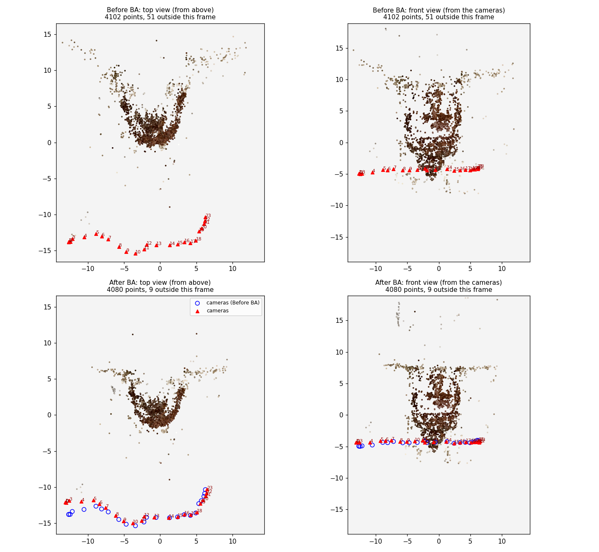
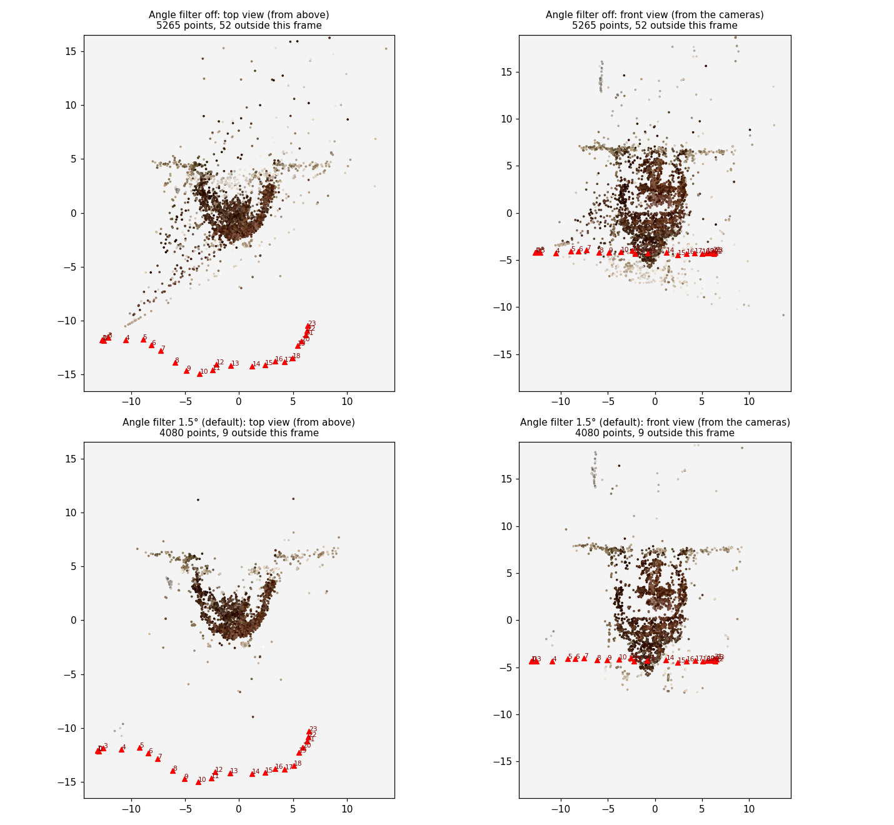

# Incremental SfM in C++ (Ceres)

A C++17 port of the Python `sfm/` package and `SFM.ipynb`. Two-view geometry (normalized
8-point, RANSAC with Sampson error, essential matrix, pose decomposition, DLT triangulation)
is written from scratch on Eigen. OpenCV provides SIFT, brute-force matching and
`solvePnPRansac`. Bundle adjustment uses Ceres instead of GTSAM.

All commands below are run from the repository root.

## Build

Requires OpenCV 4, Eigen 3.3+, Ceres 2.x and CMake 3.16+. COLMAP is optional (used only for the
`.bin` export and the GUI).

```bash
cmake -S cpp -B cpp/build && cmake --build cpp/build -j
```

## Run

The pipeline expects `<data-dir>/buddha_images/` and `<data-dir>/cameras.txt` (COLMAP text
format, `SIMPLE_RADIAL`, camera `i + 1` for image `i`).

```bash
./cpp/build/sfm_pipeline --data-dir .
```

This writes `before_ba/`, `after_ba/` (COLMAP models, text and binary) and `before_ba.ply`,
`after_ba.ply` (points plus red camera centers) to `<data-dir>/colmap_exports_cpp/`. It takes
about 33 s, almost all of it SIFT matching.

| Option | Effect |
|---|---|
| `--out-dir O` | output folder (default `<data-dir>/colmap_exports_cpp`) |
| `--seed I J` / `--auto-seed` | seed pair (default 15 16, as in the notebook) or pick it with `find_best_seed` |
| `--min-tri-angle A` | minimum triangulation angle in degrees (default 1.5, `0` = off) |
| `--no-undistort` | keep raw keypoint positions instead of removing k1 distortion |
| `--no-refine` | do not refit F on RANSAC inliers |
| `--keep-conflicting` | keep tracks that have 2+ keypoints in one image |
| `--no-binary` | skip the COLMAP `.bin` conversion |
| `--gui before\|after` | open that model in the COLMAP GUI at the end |

## Layout

| Module | Files | Ports |
|---|---|---|
| 1. Types, RNG, I/O | `types.hpp`, `rng.*`, `io.*` | `rng.py`, `io.py` |
| 2. Two-view geometry | `geometry.*` | `geometry.py` |
| 3. Matching (+ undistortion) | `matching.*`, `camera.*` | `matching.py` |
| 4. Tracks | `tracks.*` | `tracks.py` |
| 5. Incremental mapping | `mapping.*` | `mapping.py` |
| 6. Bundle adjustment | `ba.*` | `ba.py` (GTSAM → Ceres) |
| 7. Export | `export.*` | `colmap_export.py`, `viz.py` (Open3D → PLY) |
| 8. Pipeline | `main.cpp` | `SFM.ipynb` |

Headers are in `include/sfm/`, sources in `src/`. SuperPoint + LightGlue is not ported.

## Tests

Each module has a check in `tests/`: synthetic scenes with known ground truth, plus runs on
the real data where it applies. Real-data tests take `<data-dir>` as the first argument.

```bash
./cpp/build/test_geometry
```

```bash
./cpp/build/test_mapping .
```

`test_io`, `test_matching`, `test_tracks`, `test_ba` and `test_export` work the same way.
`test_matching`, `test_tracks`, `test_mapping` and `test_ba` also accept `--no-refine`,
`--no-undistort` and `--keep-conflicting`, to compare against Python-like behavior.

## Changes from the Python version

| Change | Why |
|---|---|
| Refit F on all RANSAC inliers | recall on a synthetic test rose from 0.895 to 0.948 with no extra outliers |
| Undistort keypoints (k1) right after SIFT | the whole pipeline assumes a pinhole camera; 31% of keypoints move > 4 px |
| Drop conflicting tracks | halves the observations with > 10 px error before BA |
| Depth check in both cameras when growing the map | Python tested world z; negative-depth tracks went from 15 to 0 |
| Reprojection check and >= 12 PnP inliers for new views | rejects poorly supported poses and points |
| Minimum triangulation angle 1.5° | removes points with an unconstrained depth along the ray; see results |
| BA: drop > 10 px, solve, drop > 4 px, solve again | outliers no longer bias the solution |
| BA: anchor the seed camera, fix scale, up to 100 iterations, tol 1e-6 | exact gauge; the Python LM stopped at 40 iterations |
| Forward pass starts at `seed_i + 1`, plus a catch-up pass | a non-adjacent seed no longer skips images |
| COLMAP export writes raw (distorted) 2D points | matches the SIMPLE_RADIAL model and the real images |

## Results on the 24-image Buddha set

| | Python (GTSAM) | C++, angle filter off | C++, default |
|---|---|---|---|
| Cameras registered | 24 | 24 | 24 |
| Points after BA | 5,490 | 5,265 | 4,080 |
| Negative-depth tracks before BA | 15 | 0 | 0 |
| "Final RMSE" (Python formula, √(cost / 2N)) | 3.36 px | 0.358 px | 0.391 px |
| All observations after BA: median / p90 | n/a | 0.44 / 1.24 px | 0.50 / 1.37 px |
| BA round-1 iterations / Ceres solver warnings | n/a | 96 / 16 | 34 / 0 |
| BA time | n/a | 0.75 s | 0.33 s |

The C++ and Python numbers are not from identical observation sets, so the RMSE gap reflects
the outlier filtering and track cleanup as well as the optimizer.

### Before and after bundle adjustment



Red triangles are the 24 cameras; blue circles mark where each camera was before BA. BA
straightens the flat background structure, tightens the statue (median point distance from
the cloud center 4.44 → 3.46), and moves cameras 0–3, at the end of the longest PnP chain, by
up to 1.8× the spacing between neighbouring cameras. The median reprojection error drops from
1.04 to 0.50 px.

### Minimum triangulation angle



Cameras 0–3 are nearly co-located (pair (0, 1) has 0.02° of parallax), so points triangulated
mainly from them smear along the viewing rays: the diagonal streak in the top-left panel.
With the filter off, 29 points lie more than 10× the median distance from the cloud center,
one of them about 114,000× out; with the 1.5° filter, none lie beyond 7×. These points
nearly fit their observations, which is why the filter raises the reprojection error slightly
while making the cloud cleaner. They also made the BA linear system ill-conditioned (14% of
points under 0.5°), causing the Ceres warnings and the slow first round.
